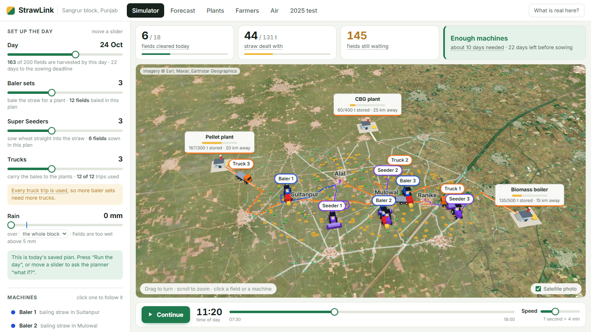
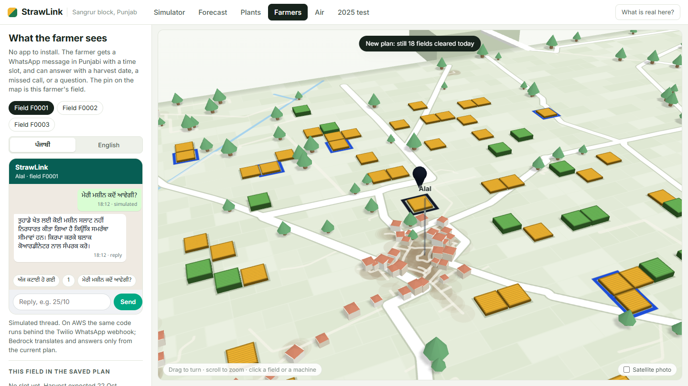
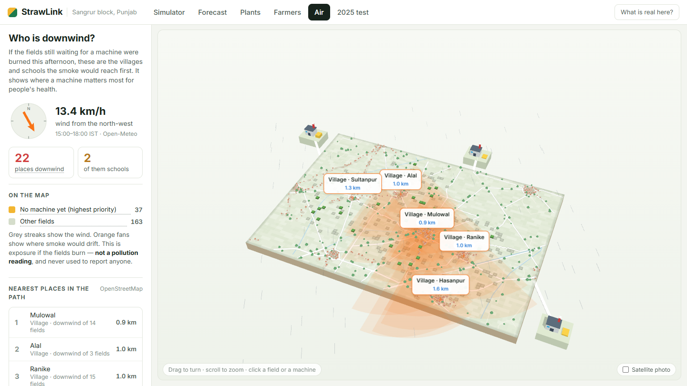
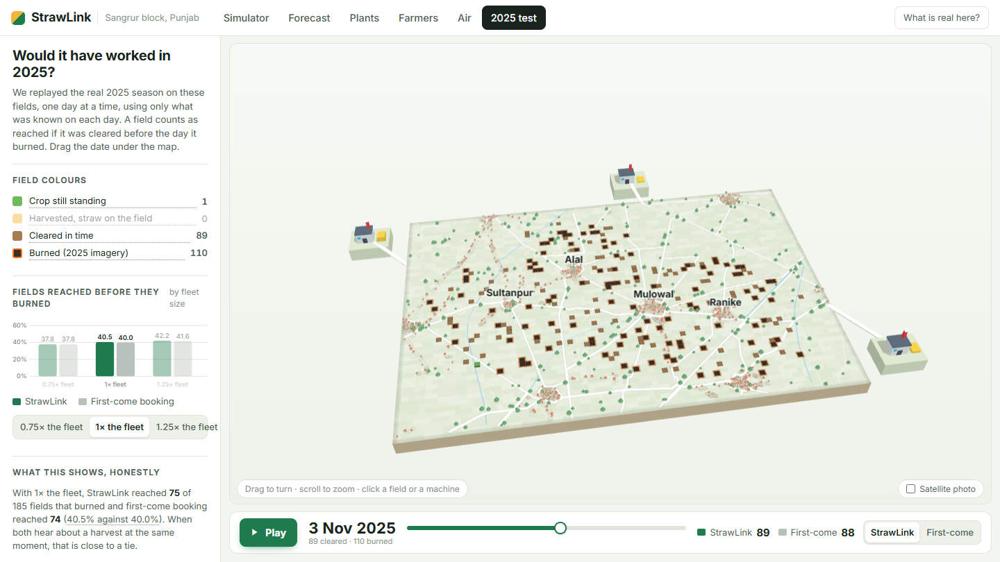

# StrawLink

**Get every paddy field cleared before wheat sowing, so no farmer needs to burn straw.**

WeMakeDevs × AWS Environmental Hacks 2026 — Air track.

**Video (3 min):** https://youtu.be/IEd7r5U8gP8

**Live:** https://main.d16side0ke5w9y.amplifyapp.com · API: https://u1feqhbpaa.execute-api.ap-south-1.amazonaws.com

Each October, farmers in Punjab have about three weeks between the rice harvest and wheat sowing.
A field whose straw is not baled or sown through in time gets burned, and the smoke reaches
villages, schools and cities downwind. Machines that can clear straw exist; what is missing is a
plan that puts the right machine on the right field on the right day.

StrawLink is that plan, for one block of 200 fields west of Sangrur:

1. **Forecast** each field's harvest date from Sentinel-2 satellite images.
2. **Listen** to farmers: a WhatsApp message, a voice note in Punjabi, Hindi or English (Amazon
   Transcribe) or a missed call overrides the forecast. Before the harvest, StrawLink writes first,
   with the window its forecast gives for that field.
3. **Choose** how each field is cleared: baled and trucked to a plant with room, or sown straight
   through with a Super Seeder.
4. **Rank** fields with a fair queue: tonnes × urgency × a bonus for not burning last season × dry.
   Burn history never raises a field's priority, and nothing here reports a farmer to anyone.
5. **Plan** every machine's day with OR-Tools, and re-plan when it rains or a farmer confirms.
   Rain is not entered by anyone: before every plan it is read from Open-Meteo for each village,
   and fields in a village that is too wet wait until it dries.
6. **Test** it honestly: the 2025 season replayed day by day against first-come booking.

## See it



The web app opens on a **Simulator**. Move a slider — day, baler sets, Super Seeders, trucks,
extra rain — and the real planner re-plans in about four seconds. The rain box shows what the
weather service reports for each village, and can replay the real rain of a past day
(27 Sep 2022: two villages too wet, two workable). Press *Run the day* and watch tractors
and trucks drive the block's real roads, clear fields and carry bales to the plants.

| Page | What it shows |
|---|---|
| Simulator | Sliders → planner → the day played on a 3D map, with a scoreboard |
| Forecast | The season scrubbed day by day; straw arriving each week |
| Plants | Bale or seed per field, the plants and how full their depots get |
| Farmers | The WhatsApp thread in Punjabi, the time slot, the clearance certificate |
| Air | Afternoon wind, villages and schools downwind of fields with no machine, and what burning today's straw would emit |
| 2025 test | The 2025 replay against first-come booking |

| Farmers | Air | 2025 test |
|---|---|---|
|  |  |  |

Screenshots are of the live site; `app/tools/screenshots.mjs` regenerates them. The video script
and the submission text are in `docs/`; the demo film is generated from the live site by the
scripts in `app/tools/film/`.

## Run it on your machine (no AWS account needed)

Python 3.11 and Node 20+.

```bash
python -m venv app/.venv
app/.venv/Scripts/python.exe -m pip install -r app/backend/requirements.txt ortools tzdata uvicorn httpx pytest "moto[dynamodb,s3,ssm,lambda]"   # Windows
# macOS / Linux: app/.venv/bin/python -m pip install … (same arguments)
npm --prefix app/web install
```

```bash
app/.venv/Scripts/python.exe app/tools/dev_server.py --date 2026-10-24 --port 8000
```

```bash
npm --prefix app/web run dev -- --port 5173
```

Open http://localhost:5173. The local API mocks AWS in memory and loads the real pipeline outputs
from `outputs/`.

Tests: `app/.venv/Scripts/python.exe -m pytest -q app/tests` (17 API tests) and
`… -m pytest -q pipeline/tests`.

## How it is built on AWS

```
Sentinel-2 (Earth Search STAC) ─► pipeline ─► S3 ─► loader Lambda ─► DynamoDB (6 tables)
                                                                        │
 web app (Amplify Hosting) ─► API Gateway (HTTP API) ─► API Lambda (FastAPI) ─┤
 WhatsApp (Twilio webhook) ─►            │                 │   │   │          │
                                         └─► worker Lambda ─► Amazon Transcribe (voice notes) ─► Bedrock ─► re-plan ─► reply
                                                           │   │   └─► Amazon Bedrock: Punjabi translation, farmer assistant (Strands Agents)
                                                           │   └─────► Amazon Location Service: road routes
                                                           └─────────► planner Lambda (OR-Tools)
 EventBridge Scheduler ─► daily re-plan Lambda (06:00 IST)
```

Everything is in one SAM template, `app/template.yaml`. To deploy without Docker or the SAM CLI:

```bash
app/tools/deploy_nodocker.sh all
```

It builds the Lambda packages from Linux wheels, creates the stack in `ap-south-1`, uploads the
data, runs the first plan and publishes the web app. It uses the AWS CLI's current login
(`AWS_PROFILE` picks one). The Bedrock model is a template parameter: the live stack runs Amazon
Nova Pro (`BEDROCK_MODEL_ID=apac.amazon.nova-pro-v1:0`), because Anthropic models need a one-time
use-case form per AWS account.

## What is real and what is not

| | |
|---|---|
| **Real** | Sentinel-2 imagery and the harvest and burn signals read from it (2022–2026); weather and wind (Open-Meteo); roads, villages and schools (OpenStreetMap); the planner, which answers every slider live |
| **Approximate** | Field outlines: 110 m grid cells on real paddy pixels, not surveyed boundaries |
| **Synthetic** | Machines, plants, phone numbers, combine bookings (`config/synthetic.yaml`) |
| **Assumed** | Every constant marked `ASSUMPTION` in `config/params.yaml`. The app lists them under *What is real here?* |

Swap the files in `data/`, `config/` and `outputs/` for real ones in the same format
(`contracts/*.schema.json`) and every page uses them.

## Results, stated plainly

- **Harvest forecast** (trained on 2022–2024, tested on 2025): the middle estimate is off by
  4.0 days on average. The "80 %" date range is too narrow — it contained only 35–43 % of real
  harvests, so it still needs widening.
- **2025 replay**, same fleet, same information for both policies: StrawLink reached 75 of 185
  burned fields before they burned, first-come booking reached 74 (40.5 % against 40.0 %).
  **That is a tie.** In 2025 most fields burned within about two days of harvest, so hearing about
  a harvest early matters more than clever routing. That is what the forecast, the farmer's
  WhatsApp and the rain re-planning are for. We did not tune the planner to win this test.
- **Burn detection** uses imagery only so far and over-counts (tillage looks like a burn scar).
  NASA FIRMS fire points are supported in the code but not yet in these numbers.
- **Emissions** on the Air page are an upper estimate from published average factors
  (Andreae 2019; IPCC 2006), not a measurement.

## Repository

```
config/      assumed constants and the synthetic fleet
contracts/   JSON schemas every file between the two halves must match
data/        fields, villages, OpenStreetMap roads, schools
outputs/     pipeline results: live forecast and plan, 2025 backtest and replay
pipeline/    satellite ingest, labels, burn detection, forecast model, planner, backtest
app/         SAM template, API, loaders, messaging, assistant, certificates, web app, tests
```

More detail: `HANDOFF.md` (history and caveats), `TODO.md` (what is done and what is left),
`app/web/README.md` (how the web app is put together).

Built by Yash (pipeline, planner, backend) and Shambhvi (web app, deployment).
